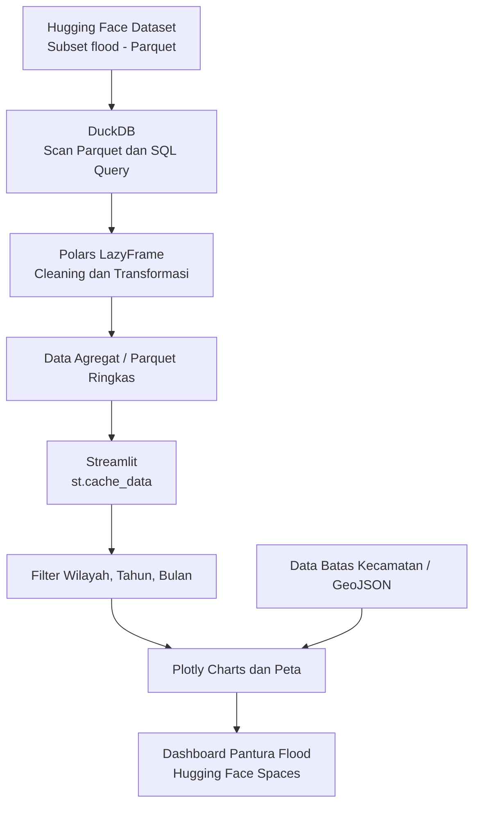

# Dokumen Arsitektur & Pitch Proposal Produk Data (Phase 1)

**Mata Kuliah:** Analisis Big Data\
**Target Check-in:** Pertemuan 10 (Diumumkan Pertemuan 8, repositori dibagikan Pertemuan 9)\
**Nama Tim:** \[PanturaFlood_119_277\]\
**Anggota Tim:** 2 orang\
**Topik / Judul Produk Data:** **Pantura Flood — Dashboard Pemantauan
Historis dan Analisis Spasio-Temporal Potensi Banjir di Wilayah Pantai
Utara Jawa 2015–2024**

------------------------------------------------------------------------

## 1. Problem Statement & Sasaran Pengguna (The Pitch)

### 1.1 Latar Belakang Masalah

Wilayah Pantai Utara Jawa (Pantura) merupakan kawasan yang memiliki
aktivitas permukiman, ekonomi, dan infrastruktur yang padat serta
menghadapi potensi permasalahan hidrologis, termasuk banjir. Curah hujan
dan perubahan debit sungai merupakan beberapa indikator yang relevan
untuk memahami kondisi hidrologis suatu wilayah. Namun, data yang
tersimpan dalam jumlah besar dan memiliki dimensi waktu serta lokasi
perlu diolah agar pola dan perbedaannya dapat dipahami dengan lebih
mudah.

Proyek **Pantura Flood** mengembangkan dashboard analitik untuk
mengeksplorasi data historis potensi banjir di wilayah Pantura Jawa
selama periode 2015–2024. Dashboard memanfaatkan data harian mengenai
akumulasi curah hujan, debit sungai, perubahan debit, identitas
kecamatan, serta label indikator potensi banjir. Data diolah menggunakan
DuckDB dan Polars, kemudian disajikan secara interaktif melalui
Streamlit dan Plotly.

Dashboard ini berfokus pada pemantauan historis dan analisis pola
spasio-temporal. Produk ini bukan sistem pemantauan real-time dan bukan
sistem peringatan dini operasional. Label potensi banjir pada dataset
merupakan indikator berbasis ambang debit sungai, sehingga tidak boleh
ditafsirkan sebagai konfirmasi bahwa banjir benar-benar terjadi di
lapangan.

### 1.2 Target Pengguna (Target Audience)

1.  **Analis kebencanaan dan lingkungan daerah**, sebagai sarana
    eksplorasi pola indikator potensi banjir berdasarkan waktu dan
    kecamatan.
2.  **Instansi pemerintah daerah dan perencana wilayah**, sebagai
    informasi pendukung untuk memahami variasi kondisi hidrologis
    antarwilayah.
3.  **Mahasiswa dan peneliti**, sebagai media eksplorasi data historis
    curah hujan, debit sungai, serta indikator potensi banjir.
4.  **Masyarakat umum**, untuk memperoleh gambaran historis kondisi dan
    pola potensi banjir di wilayah Pantura melalui visualisasi yang
    mudah dipahami.

### 1.3 Nilai Tambah & Wawasan Utama

Melalui dashboard ini, pengguna diharapkan dapat:

-   Melihat ringkasan data dan jumlah catatan indikator potensi banjir
    selama periode pengamatan.
-   Membandingkan pola indikator potensi banjir antar-kecamatan dan
    antar-tahun.
-   Mengamati perubahan curah hujan berdasarkan akumulasi 1, 3, 7, dan
    30 hari.
-   Menganalisis kondisi debit sungai saat pengamatan, rata-rata debit
    tujuh hari, dan perubahan debit tiga hari.
-   Mengidentifikasi bulan atau periode yang memiliki frekuensi label
    potensi banjir lebih tinggi.
-   Mengeksplorasi persebaran indikator potensi banjir pada peta setelah
    data `district_id` dihubungkan dengan data batas wilayah kecamatan.

Wawasan yang dihasilkan bersifat deskriptif dan eksploratif. Dashboard
tidak menyatakan hubungan sebab-akibat dan tidak menghasilkan prediksi
baru di luar label yang telah tersedia pada dataset.

------------------------------------------------------------------------

## 2. Sumber Dataset & Skala Data

| Parameter | Keterangan |
|---|---|
| **Nama Dataset** | SIAGA Pantura Hazard Data — subset `flood` |
| **Sumber Resmi** | [Hugging Face — ethanchrstian/siaga-pantura-hazard-data](https://huggingface.co/datasets/ethanchrstian/siaga-pantura-hazard-data) |
| **Subset yang Digunakan** | `flood` saja. Subset `drought` dan `risk_history` tidak digunakan dalam proyek ini. |
| **Split** | `train` |
| **Format Awal** | Parquet |
| **Ukuran Data** | Sekitar 1,15 juta baris (tampilan dataset menunjukkan 1.15M rows; jumlah tepat perlu dikonfirmasi kembali saat membaca file). |
| **Cakupan Wilayah** | Wilayah Pantai Utara Jawa; dokumentasi dataset menyebut 324 kecamatan pada 18 kabupaten/kota. |
| **Dimensi Waktu / Temporal** | 2015–2024, dengan catatan data harian. |
| **Teknologi Pengolahan** | DuckDB, Polars, Streamlit, dan Plotly. |
| **Fitur / Kolom Kunci** | `district_id`, `date`, `year`, `month`, `rain_1d`, `rain_3d`, `rain_7d`, `rain_30d`, `disc_now`, `disc_7d_mean`, `disc_change_3d`, `coastal`, `flood_label` (rincian pada 2.1). |

### 2.1 Fitur / Kolom Kunci

| Kolom | Tipe pada Tampilan Dataset | Keterangan |
|---|---|---|
| `district_id` | large_string | Kode identitas kecamatan untuk pengelompokan dan pengaitan dengan data geospasial. |
| `date` | timestamp[us] | Tanggal pengamatan. |
| `year` | int32 | Tahun pengamatan. |
| `rain_1d` | float64 | Akumulasi curah hujan satu hari. |
| `rain_3d` | float64 | Akumulasi curah hujan tiga hari. |
| `rain_7d` | float64 | Akumulasi curah hujan tujuh hari. |
| `rain_30d` | float64 | Akumulasi curah hujan 30 hari. |
| `disc_now` | float64 | Debit sungai pada waktu pengamatan. |
| `disc_7d_mean` | float64 | Rata-rata debit sungai selama tujuh hari. |
| `disc_change_3d` | float64 | Perubahan debit sungai dalam rentang tiga hari. |
| `month` | int32 | Bulan pengamatan (1–12). |
| `coastal` | int8 | Penanda kategori wilayah pesisir sebagaimana didefinisikan dataset. |
| `flood_label` | float64 | Label indikator potensi banjir; nilai 1 menunjukkan label positif dan 0 menunjukkan label negatif. |

------------------------------------------------------------------------

## 3. Diagram Arsitektur Data & Aliran Informasi

Aliran data dirancang agar file Parquet tidak perlu dimuat seluruhnya ke
memori antarmuka. DuckDB digunakan untuk membaca dan melakukan kueri
analitik, Polars untuk transformasi lanjutan, lalu hasil ringkasan
disajikan melalui Streamlit dan Plotly.



### Alur informasi

1.  Dataset subset `flood` diunduh atau dibaca dari file Parquet sumber.
2.  DuckDB membaca file Parquet dan menjalankan kueri seleksi, filter,
    serta agregasi.
3.  Polars melakukan pembersihan dan transformasi data yang diperlukan
    untuk analisis.
4.  Hasil agregasi disimpan sebagai data ringkas agar proses visualisasi
    lebih efisien.
5.  Streamlit menyediakan filter interaktif dan memanggil fungsi
    analitik yang telah diberi cache.
6.  Plotly menyajikan grafik, sedangkan peta dibuat dengan menghubungkan
    `district_id` ke data batas kecamatan yang sesuai.
7.  Aplikasi dipublikasikan melalui Hugging Face Spaces sesuai
    konfigurasi deployment.

------------------------------------------------------------------------

## 4. Rencana Pemrosesan Data & Strategi Caching

### 4.1 Peran DuckDB (SQL Engine)

DuckDB digunakan sebagai mesin kueri analitik untuk membaca Parquet
secara langsung dan mengurangi kebutuhan memuat seluruh data mentah ke
memori.

Rencana penggunaan:

-   Membaca file Parquet subset `flood` menggunakan `read_parquet()`.
-   Memilih kolom yang diperlukan untuk setiap kebutuhan analisis.
-   Memfilter data berdasarkan tahun, bulan, dan `district_id`.
-   Menghitung jumlah catatan, jumlah label positif, proporsi
    `flood_label = 1`, serta ringkasan curah hujan dan debit.
-   Melakukan agregasi berdasarkan tanggal, bulan, tahun, dan kecamatan.
-   Menghasilkan tabel ringkasan untuk tren temporal dan perbandingan
    antarwilayah.
-   Menyimpan hasil agregasi yang sering digunakan ke file Parquet
    ringkas jika diperlukan.

Contoh kueri agregasi:

```sql
SELECT
    year,
    month,
    COUNT(*) AS total_records,
    SUM(CASE WHEN flood_label = 1 THEN 1 ELSE 0 END) AS positive_label_records,
    AVG(rain_1d) AS avg_rain_1d,
    AVG(disc_now) AS avg_discharge
FROM read_parquet('flood_dataset.parquet')
GROUP BY year, month
ORDER BY year, month;
```

Nama file pada contoh di atas merupakan placeholder dan akan disesuaikan
dengan lokasi file sebenarnya.

### 4.2 Peran Polars (Transformasi Data)

Polars digunakan untuk transformasi data secara efisien, terutama
melalui `LazyFrame` agar operasi dapat dioptimalkan sebelum dieksekusi.

Rencana penggunaan:

-   Memeriksa tipe data, nilai kosong, duplikasi, dan rentang tanggal.
-   Memastikan kolom tanggal terbaca sebagai tipe tanggal/waktu yang
    benar.
-   Menyeragamkan tipe data kolom numerik dan kategori bila diperlukan.
-   Membentuk agregasi harian, bulanan, tahunan, dan per kecamatan.
-   Menghitung proporsi label positif berdasarkan kelompok waktu atau
    wilayah.
-   Menyiapkan tabel ringkasan untuk grafik dan peta.
-   Mengekspor hasil transformasi terpilih ke Parquet agar mudah dibaca
    kembali.

Transformasi tidak mengubah makna `flood_label`. Analisis akan
membedakan jumlah catatan berlabel positif dari jumlah kejadian banjir
aktual.

### 4.3 Strategi Optimasi Memori & Caching Streamlit

Untuk menjaga aplikasi tetap responsif:

-   Gunakan kueri DuckDB yang hanya mengambil kolom dan rentang data
    yang diperlukan.
-   Gunakan Polars `scan_parquet()` dan operasi lazy untuk transformasi
    yang sesuai.
-   Terapkan `@st.cache_data` pada fungsi pembacaan ringkasan dan kueri
    yang berulang.
-   Jadikan pilihan tahun, bulan, dan kecamatan sebagai parameter fungsi
    cache agar hasil diperbarui sesuai filter.
-   Hindari menyimpan seluruh dataset mentah di `st.session_state`.
-   Simpan hasil agregasi yang sering digunakan sebagai file Parquet
    ringkas.
-   Uji penggunaan memori dan waktu respons pada lingkungan deployment
    sebelum aplikasi dipublikasikan.

------------------------------------------------------------------------

## 5. Rencana Tampilan Dashboard (Wireframe & Fitur UI)

Dashboard **Pantura Flood** dirancang dengan tampilan ringkas,
informatif, dan mudah digunakan.

### 5.1 Header & Key Metrics KPI

Empat kartu ringkasan yang direncanakan:

1.  **Total Catatan Pengamatan** — jumlah baris data sesuai filter
    aktif.
2.  **Jumlah Catatan Label Positif** — jumlah baris dengan
    `flood_label = 1`, bukan jumlah kejadian banjir terverifikasi.
3.  **Proporsi Label Positif** — persentase catatan berlabel positif
    terhadap seluruh catatan pada filter aktif.
4.  **Rata-rata Curah Hujan Harian** — rata-rata `rain_1d` pada data
    terfilter.

Nilai KPI dihitung dari dataset, bukan ditetapkan sebagai angka statis.

### 5.2 Filter Interaktif (Sidebar)

-   Rentang tahun: 2015–2024.
-   Pilihan bulan: Januari–Desember.
-   Pilihan kecamatan (`district_id`).
-   Kategori wilayah pesisir (`coastal`), mengikuti definisi sumber.
-   Tombol reset filter.

Filter hanya menampilkan pilihan yang tersedia pada data yang berhasil
dimuat.

### 5.3 Panel Visualisasi Utama

**Tab 1 — Tren Temporal**

-   Grafik tren jumlah catatan berlabel positif per bulan dan tahun.
-   Grafik tren rata-rata curah hujan.
-   Perbandingan pola antar-tahun.

**Tab 2 — Analisis Curah Hujan dan Debit Sungai**

-   Grafik curah hujan berdasarkan jendela 1, 3, 7, dan 30 hari.
-   Grafik debit sungai saat pengamatan dan rata-rata tujuh hari.
-   Scatter plot untuk mengeksplorasi hubungan curah hujan, debit
    sungai, dan label potensi banjir.
-   Grafik perubahan debit sungai tiga hari.

**Tab 3 — Peta Wilayah / Spasial**

-   Peta choropleth atau peta kecamatan berdasarkan proporsi catatan
    `flood_label = 1`.
-   Peta perbandingan wilayah berdasarkan jumlah catatan positif.
-   Peta hanya ditampilkan setelah `district_id` berhasil dicocokkan
    dengan geometri kecamatan yang sesuai.
-   Jika pencocokan geometri belum tersedia atau tidak lengkap,
    tampilkan tabel/ranking wilayah sebagai alternatif dan jelaskan
    keterbatasannya.

**Tab 4 — Tabel Data Detail**

-   Tabel data sesuai filter aktif.
-   Kolom utama: tanggal, kecamatan, curah hujan, debit sungai, kategori
    pesisir, dan `flood_label`.
-   Opsi unduh data hasil filter atau tabel agregasi dalam format CSV.

**Catatan penyajian:** Dashboard menggunakan istilah "catatan berlabel
positif" atau "indikator potensi banjir" agar tidak menyamakan label
dataset dengan kejadian banjir aktual.

------------------------------------------------------------------------

## 6. Pembagian Tugas & Tanggung Jawab Anggota Tim

Tim terdiri dari **2 anggota**, sehingga peran frontend dan backend dibagi bersama.

| Anggota Tim | Tanggung Jawab Utama Phase 1–4 |
|---|---|
| **Rizqullah Atsir Dafa Childyasa Nusa** (Project Lead / Data Engineering, Analytics & Backend) | Koordinasi perencanaan dan pembagian kerja proyek; unduh dan pemeriksaan dataset subset `flood`; eksplorasi dan validasi kualitas data (tipe data, nilai kosong, duplikasi, rentang waktu dan nilai); pipeline Parquet dengan DuckDB dan Polars; data cleaning, seleksi kolom, transformasi, serta agregasi temporal dan wilayah; kueri dan fungsi analitik untuk KPI, tren, dan ringkasan; optimasi pembacaan data dan caching sisi backend; konfigurasi aplikasi dan deployment ke Hugging Face Spaces |
| **Ayesha Fahrelia Ningrum** (Frontend Developer / UI/UX & Dashboard Interface) | Penyusunan kebutuhan tampilan dari sasaran pengguna; wireframe, layout, dan rancangan UI/UX dashboard; implementasi antarmuka Streamlit (header, sidebar, kartu KPI, tab, panel grafik, tabel); tata letak visualisasi tren temporal, curah hujan, debit sungai, dan peta wilayah; filter tahun, bulan, kecamatan, dan kategori wilayah pesisir; konsistensi warna, tipografi, ikon, dan spacing; pemeriksaan tampilan di berbagai ukuran layar |
| **Bersama** | Menyepakati kebutuhan pengguna, fitur dashboard, dan definisi metrik; menentukan format data atau fungsi penghubung backend dan frontend; integrasi hasil pengolahan data dengan tampilan dashboard; memastikan angka, label, grafik, tabel, dan peta konsisten dengan hasil analisis; pengujian interaktivitas dan performa serta perbaikan; penyusunan dokumentasi, laporan, presentasi, dan demonstrasi produk |

------------------------------------------------------------------------

**Batasan proyek:** Pantura Flood merupakan dashboard eksplorasi data
historis 2015–2024. Dashboard menganalisis indikator potensi banjir
yang tersedia pada subset `flood`; dashboard tidak mengklaim sebagai
sistem real-time, sistem peringatan dini, atau verifikasi kejadian
banjir aktual.
